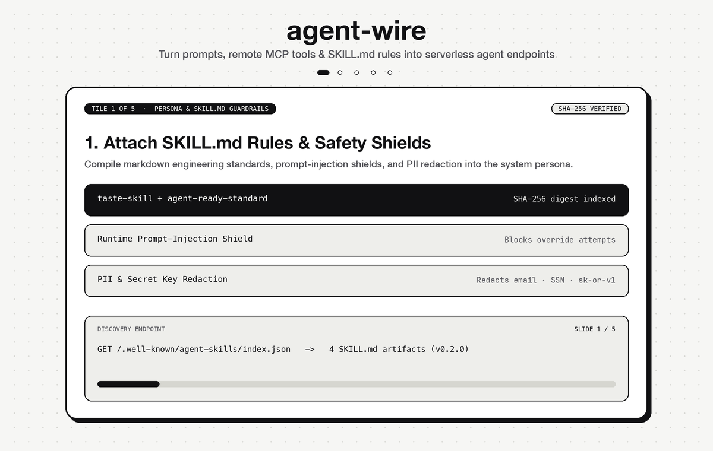

# agent-wire

Turn prompts, remote MCP connectors, and `SKILL.md` rules into curlable serverless agent endpoints, MCP servers, Google A2A v1.0 peers, and OpenAI v1 SDK facades.

**Live Studio & Endpoint:** [https://h3manth.com/ai/agent-wire/](https://h3manth.com/ai/agent-wire/)



```bash
git clone https://github.com/hemanth/agent-wire.git
cd agent-wire
npm install
npm run server
```

## Quick start

Deploy an agent via curl or the web studio:

```bash
curl -X POST http://localhost:8787/api/agents \
  -H "Content-Type: application/json" \
  -d '{
    "name": "Design Critic",
    "slug": "design-critic",
    "systemPrompt": "Enforce high craft and contrast on proposed UI.",
    "models": ["anthropic/claude-sonnet-4", "google/gemini-2.5-pro", "openai/o3-mini"],
    "reasoningEffort": "medium",
    "responseFormat": "text",
    "guardrails": { "blockPromptInjection": true, "redactPii": true },
    "mcps": [{
      "id": "stitch",
      "name": "Stitch MCP",
      "url": "https://stitch.googleapis.com/mcp",
      "type": "http"
    }],
    "skills": [{
      "id": "taste-skill",
      "name": "Taste Skill",
      "content": "Verify contrast >= 4.5:1. No gradient text. No nested cards."
    }]
  }'
```

Returns an agent object with a permanent, curlable endpoint `id`.

## Run task (JSON, SSE Streaming & Structured Output)

```bash
# Standard JSON execution
curl -X POST http://localhost:8787/api/agents/agt_design_critic/run \
  -H "Content-Type: application/json" \
  -H "Authorization: Bearer $OPENROUTER_API_KEY" \
  -d '{"input": "Audit this hero section: <button class=\"bg-blue-500 text-white\">Click</button>"}'

# Real-time Server-Sent Events (SSE) stream
curl -N -X POST http://localhost:8787/api/agents/agt_design_critic/run \
  -H "Content-Type: application/json" \
  -d '{"input": "Audit typography hierarchy", "stream": true}'
```

`POST /api/agents/:id/run` probes remote MCP tools, injects `SKILL.md` rules, delegates to A2A sub-agents, enforces safety guardrails, and returns JSON or `text/event-stream` (`step`, `delta`, `result`, `done`).

## Multi-Protocol Interoperability (Modern AI Stack)

Every deployed agent automatically exposes four standard protocols:

1. **Native MCP Server (Streamable HTTP JSON-RPC 2.0)** — `POST /mcp`
   Exposes `list_agents`, `run_agent`, and `agent_<slug>` tools plus `agent://<id>` and `skill://<id>` resources.
2. **Google A2A v1.0 Protocol** — `POST /api/a2a` & `GET /.well-known/agent-card.json`
   Supports `tasks/send` (`message/send`), `tasks/get`, and `tasks/cancel` for multi-agent peer handoffs.
3. **OpenAI v1 SDK Facade** — `GET /v1/models`, `POST /v1/chat/completions`, `POST /v1/responses`
   Point any OpenAI client (`baseURL: "http://localhost:8787/v1"`) at `model: "agentwire/design-critic"`.
4. **Automated Agent Evals** — `POST /api/agents/:id/eval`
   Runs deterministic capability, tool-grounding, and prompt-injection guardrail suites.

## Level 5 Agent-Native Discovery (`/.well-known/*`)

- `Accept: text/markdown` on `/` returns a token-counted Markdown twin (`x-markdown-tokens`).
- `/.well-known/mcp/server-card.json` (SEP-1649 MCP Server Card)
- `/.well-known/agent-card.json` (Google A2A v1.0 Agent Card)
- `/.well-known/agent-skills/index.json` (Agent Skills Index v0.2.0 with SHA-256 digests)
- `/.well-known/api-catalog` (RFC 9727 `application/linkset+json`)
- `/.well-known/http-message-signatures-directory` (RFC 9421 Web Bot Auth Ed25519 JWKS)
- `/openapi.json`, `/llms.txt`, `/auth.md`, `/robots.txt`

## Deploy to Cloudflare

```bash
npm run deploy
```

`wrangler deploy` publishes the edge worker and serves the studio static assets via Cloudflare Workers.

## License

MIT © [Hemanth.HM](https://h3manth.com)
